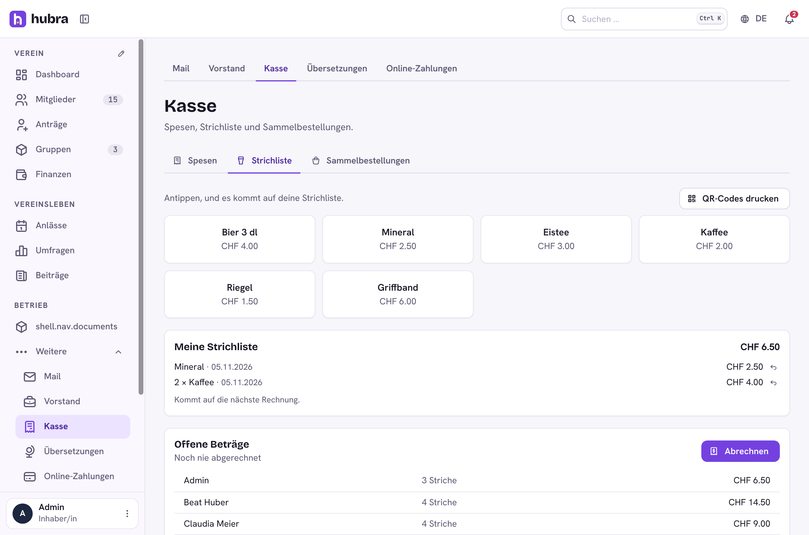

# Kasse

[](https://github.com/hubra-app/hubra-plugin-kasse/actions/workflows/release.yml?query=branch%3Amain) [](https://github.com/hubra-app/hubra-plugin-kasse/releases/latest) [](LICENSE)

A plugin for [Hubra](https://hubra.club). Money between members and the club outside the membership fee: expense claims with a receipt photo, a drinks and materials tab (Strichliste) with QR codes at the fridge, and collective orders for club clothing. Totals go on the member's invoice.

**Version** 1.0.0 · **Works with** Hubra >=0.2,<1 · **Plugin id** `kasse` · **Needs** the members and finance modules, and Hubra's file store for receipts



## What it does

| Tab | |
| --- | --- |
| Spesen | A member hands in an expense with a receipt. The treasurer approves or rejects it, then pays it: that books an expense in Finanzen with the member and the chosen category. |
| Strichliste | Products with a price; members tick them in the app or by scanning a code from the printed QR sheet. Settling creates one invoice per member for what is open. |
| Sammelbestellungen | Items with prices and sizes and an order deadline. Members order; the board gets the supplier list (CSV), closes the order and bills it, one invoice per member. |

Invoices are ordinary Hubra invoices (purpose "other"), so they show on the
member's invoices and follow the usual reminders and payment.

Permissions: `kasse.claims.read`, `kasse.claims.update`, `kasse.tab.update`,
`kasse.orders.update`. Every member can hand in claims, tick and order.

## Install

Platform admins install it from the plugin catalogue in the manager portal
(official Marketplace, <https://plugins.hubra.club/index.json>, signed with
the Hubra project key). Clubs then switch it on under Einstellungen → Module
& Plugins.

## Develop

Clone this repository into `plugins/kasse` of a Hubra checkout. Its tests
then run with Hubra's (`cd app/backend && pytest ../../plugins/kasse`), and
`npm run build:plugin` in `app/frontend` builds its frontend. The workflow
does the same against Hubra's `main` on every push and pull request.

## Releasing

Bump `version` in `plugin.yaml`, add a `## <version>` section to
`CHANGELOG.md`, commit, then publish a GitHub release tagged `v<version>`
(web UI, or `gh release create v<version> --target main --notes ""`). The
workflow tests the plugin and builds its frontend; a separate job in the
`plugin-signing` environment, the only one with the `HUBRA_SIGNING_KEY`
secret, signs it; then `kasse-<version>.zip` is attached to the release. Files listed in `.releaseignore` stay out of the zip.
`CHANGELOG.md` and merge. Then tag the merged commit on main and push the tag:

```sh
git switch main && git pull
git tag v<version> && git push origin v<version>
```

The workflow tests the plugin and builds its frontend, the `plugin-signing`
job signs it after your approval, and only then is the GitHub release
`v<version>` published, with `<id>-<version>.zip` and its `.sha256` attached. Files
listed in `.releaseignore` stay out of the zip. Releases are immutable, so a
published version never changes: fix a bad one with a new version. The template itself is never signed.

Source: <https://github.com/hubra-app/hubra-plugin-kasse>
